# 4. FT. CAPTURA DE REQUISITOS

## 4.1 Identificar Actores y Casos de Uso

### 4.1.1 Identificar Actores

Un actor es un rol externo al sistema que interactúa con él para alcanzar un objetivo propio. No son actores las tablas de la base de datos ni los procesos internos del sistema. En este sistema los actores son los tres perfiles definidos en la historia de usuario. Como los tres comparten el acceso (CU01), la búsqueda de pacientes (CU03) y el historial del paciente (CU15), se generalizan en el actor abstracto **Usuario**.

La base de datos PostgreSQL en Neon y la plataforma Vercel son servicios que el sistema consume, pero no inician ningún caso de uso; por eso no se modelan como actores y aparecen solo en el diagrama de despliegue (6.1.1). El paciente participa en el proceso de negocio (capítulo 3), pero no usa el sistema directamente.

<!-- casos_uso:actores -->

Los límites de acceso de la tabla se aplican en la interfaz: el menú de cada perfil (`MENUS` en `components/perfil-provider.tsx`) y los permisos derivados `puedeEditarPacientes`, `puedeGestionarCitas` y `puedeRegistrarAtencion` deciden qué opciones y botones se muestran. La API no verifica el perfil.

### 4.1.2 Identificar Casos de Uso

Los casos de uso se obtuvieron de los módulos y reglas de la historia de usuario #1 y se contrastaron con las pantallas y rutas de API implementadas. Las altas, bajas, modificaciones y consultas de un mismo objeto se agrupan en un caso de uso «Gestionar»; las validaciones (CI único, choques, horario) son pasos de los flujos y no casos de uso propios.

- CU01: Seleccionar perfil
- CU02: Gestionar pacientes
- CU03: Buscar paciente
- CU04: Gestionar odontólogos
- CU05: Definir horario de atención
- CU06: Gestionar tratamientos
- CU07: Reservar cita
- CU08: Consultar disponibilidad del odontólogo
- CU09: Reprogramar cita
- CU10: Cancelar cita
- CU11: Confirmar cita
- CU12: Consultar agenda de citas
- CU13: Consultar agenda del día
- CU14: Registrar atención
- CU15: Consultar historial del paciente
- CU16: Consultar tablero

<!-- casos_uso:listado -->

, generado desde docs/casos_uso.js.")

## 4.2 Priorizar Casos de Uso

La prioridad refleja cuánto depende el objetivo de la historia de usuario de cada caso de uso, y el riesgo, cuánto daño causa un defecto en él. La complejidad se mide como **A = 3** (varias tablas, transacción), **M = 2** (gestión con validaciones y permisos) y **B = 1** (consulta simple). El ciclo 1 reúne la base (acceso, pacientes, odontólogos, horarios y tratamientos) y la operación núcleo, la reserva de citas con su consulta de disponibilidad; el ciclo 2 contiene lo que depende de que existan citas: cambios de estado, agendas, atención, historial y tablero.

| Distribución | Ciclo 1 | Ciclo 2 |
|---|---|---|
| Casos de uso | 8 (CU01 a CU08) | 8 (CU09 a CU16) |
| Paquetes | P1, P2 y P3 (CU07, CU08) | P3 (CU09 a CU11) y P4 |
| Complejidad A / M / B | 1 / 4 / 3 | 2 / 2 / 4 |
| Puntos | 14 | 14 |

El reparto se verifica al cargar `docs/casos_uso.js`: el catálogo lanza un error si los ciclos no tienen el mismo número de casos de uso, si la diferencia de puntos supera 2 o si los paquetes de una misma capa no tienen el mismo tamaño. Los paquetes P1 y P2 tienen 3 casos de uso y P3 y P4 tienen 5. No se forzó el reparto recomendado de 4 paquetes de igual tamaño porque los casos de uso que no dependen de las citas son seis; llevar uno de ellos a P3 o P4, o llevar una consulta de citas a P1 o P2, crearía una dependencia circular entre paquetes, y añadir casos de uso para igualar sería inventar funcionalidad. Por la misma razón P3 se reparte entre los dos ciclos.

<!-- casos_uso:priorizacion -->

**Ciclo 1**

| ID | Caso de uso | Estado | Prioridad | Riesgo | Actores | Complejidad |
|---|---|---|---|---|---|---|
| CU01 | Seleccionar perfil | Incluido | Crítica | Medio | Usuario | B |
| CU02 | Gestionar pacientes | Incluido | Crítica | Significativo | Recepcionista, Administrador | M |
| CU03 | Buscar paciente | Incluido | Importante | Ordinario | Recepcionista, Odontólogo, Administrador | B |
| CU04 | Gestionar odontólogos | Incluido | Crítica | Significativo | Administrador | M |
| CU05 | Definir horario de atención | Incluido | Crítica | Significativo | Administrador | M |
| CU06 | Gestionar tratamientos | Incluido | Crítica | Medio | Administrador | M |
| CU07 | Reservar cita | Incluido | Crítica | Crítico | Recepcionista, Administrador | A |
| CU08 | Consultar disponibilidad del odontólogo | Incluido | Importante | Medio | Recepcionista, Administrador | B |

**Ciclo 2**

| ID | Caso de uso | Estado | Prioridad | Riesgo | Actores | Complejidad |
|---|---|---|---|---|---|---|
| CU09 | Reprogramar cita | Incluido | Crítica | Crítico | Recepcionista, Administrador | A |
| CU10 | Cancelar cita | Incluido | Crítica | Significativo | Recepcionista, Administrador | M |
| CU11 | Confirmar cita | Incluido | Media | Ordinario | Recepcionista, Administrador | B |
| CU12 | Consultar agenda de citas | Incluido | Importante | Ordinario | Recepcionista, Administrador | B |
| CU13 | Consultar agenda del día | Incluido | Importante | Ordinario | Odontólogo, Administrador | B |
| CU14 | Registrar atención | Incluido | Crítica | Significativo | Odontólogo, Administrador | A |
| CU15 | Consultar historial del paciente | Incluido | Importante | Ordinario | Recepcionista, Odontólogo, Administrador | B |
| CU16 | Consultar tablero | Incluido | Importante | Medio | Recepcionista, Administrador | M |

El tablero (CU16) aparece en la historia de usuario como función del administrador; en el código el menú «Tablero» se muestra también a la recepcionista, que además lo tiene como página de inicio. La documentación refleja el comportamiento implementado.

## 4.3 Detallar Casos de Uso

Cada ficha recoge el comportamiento implementado. Los mensajes entre comillas latinas son los textos reales de la interfaz o de la API; los códigos HTTP y de error son los de `lib/http.ts` y `lib/agenda.ts`. El sistema no lleva bitácora de auditoría, por lo que ningún flujo la registra.

### 4.3.1 Ciclo 1

#### CU01 Seleccionar perfil

<!-- ficha -->
|  | |
|---|---|
| Caso de uso | CU01: Seleccionar perfil |
| Propósito | Mostrar a cada persona solo las opciones de su rol, en sustitución del inicio de sesión que la historia de usuario deja fuera de alcance. |
| Descripción | El usuario abre la aplicación y elige Recepcionista, Odontólogo o Administrador; si elige Odontólogo, indica quién es entre los odontólogos activos. El sistema guarda el perfil en el navegador y muestra el menú correspondiente. No hay contraseña ni verificación en el servidor. |
| Actor(es) | Usuario (Recepcionista, Odontólogo, Administrador) |
| Actor iniciador | Usuario |
| Paquete y ciclo | P1 Acceso y pacientes · Ciclo 1 |
| Relaciones | Generalización: Recepcionista, Odontólogo y Administrador especializan a Usuario porque los tres realizan este caso de uso. Ninguna relación «include» o «extend». |
| Precondición | • La aplicación está disponible en el navegador. • Para el perfil Odontólogo existe al menos un odontólogo activo (CU04). |
| Flujo principal | 1. El usuario abre la ruta «/». 2. El sistema muestra las tarjetas «Recepcionista», «Odontólogo» y «Administrador» con su descripción. 3. El usuario pulsa «Ingresar» en Recepcionista o Administrador. 4. El sistema guarda el perfil en `localStorage` (clave `consultorio.perfil`) y redirige a «Tablero». 5. El sistema muestra el menú lateral del perfil y su nombre. |
| Flujos alternativos | A1. Perfil Odontólogo: en el paso 3 el usuario pulsa «Elegir odontólogo»; el sistema consulta los odontólogos activos y muestra «¿Quién eres?»; el usuario elige su nombre y pulsa «Ingresar a mi agenda»; el sistema guarda el perfil con el id del odontólogo y redirige a «Mi agenda del día». A2. Cambiar perfil: desde cualquier pantalla el usuario pulsa «Cambiar perfil»; el sistema borra el perfil guardado y vuelve a «/». |
| Postcondición | • El navegador conserva el perfil (y el id del odontólogo) hasta que se cambie. • El menú lateral muestra solo las opciones del perfil. |
| Excepciones | E1. No se puede cargar la lista de odontólogos: el sistema muestra «No se pudo cargar la lista» con el detalle del error. E2. Se abre una página del panel sin perfil: el sistema redirige a «/». |
| Clases de análisis previstas | Vista: Vperfil Control: Cperfil Entidad: Eodontologo |

#### CU02 Gestionar pacientes

<!-- ficha -->
| 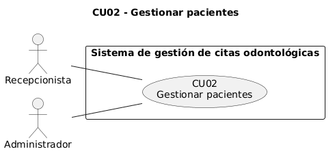 | |
|---|---|
| Caso de uso | CU02: Gestionar pacientes |
| Propósito | Mantener un registro único de pacientes identificados por su CI (regla «CI único» de la historia #1). |
| Descripción | La recepcionista registra pacientes con nombre, apellido, CI y teléfono, y opcionalmente correo y fecha de nacimiento; luego puede editarlos o eliminarlos desde su ficha. El sistema normaliza el CI a mayúsculas, valida los formatos, rechaza un CI repetido y no elimina pacientes que tienen citas. |
| Actor(es) | Recepcionista, Administrador |
| Actor iniciador | Recepcionista |
| Paquete y ciclo | P1 Acceso y pacientes · Ciclo 1 |
| Relaciones | Ninguna relación «include» o «extend». |
| Precondición | • Perfil Recepcionista o Administrador elegido (CU01). |
| Flujo principal | 1. La recepcionista entra a «Pacientes» y pulsa «Nuevo paciente». 2. El sistema muestra el formulario con «Nombre», «Apellido», «Cédula de identidad (CI)», «Teléfono», «Correo electrónico» y «Fecha de nacimiento». 3. La recepcionista completa los datos y guarda. 4. El sistema valida el CI (4 a 12 dígitos y complemento opcional), el teléfono (6 a 20 caracteres), el correo y que la fecha de nacimiento no sea futura, y comprueba que el CI no exista. 5. El sistema registra el paciente y muestra «Paciente registrado». |
| Flujos alternativos | A1. Editar: en la ficha del paciente pulsa «Editar»; el sistema precarga los datos y, al guardar, aplica las mismas validaciones y muestra «Paciente actualizado». A2. Eliminar: en la ficha pulsa «Eliminar» y confirma «¿Eliminar paciente?»; el sistema elimina el registro. |
| Postcondición | • Existe una fila en Paciente con el CI en mayúsculas y único. • En A2, la fila deja de existir. |
| Excepciones | E1. Datos no válidos: 400 VALIDACION y mensaje junto al campo, por ejemplo «El CI debe tener entre 4 y 12 dígitos y un complemento opcional (ej. 1234567-1A)». E2. CI repetido al crear o editar: 409 CI_DUPLICADO «Ya existe un paciente con CI … (nombre apellido)». E3. Paciente con citas: 409 EN_USO «No se puede eliminar al paciente porque tiene N cita(s) registrada(s)». E4. Paciente inexistente: 404 «No existe el paciente con id N». |
| Clases de análisis previstas | Vista: Vpaciente Control: Cpaciente Entidad: Epaciente |

#### CU03 Buscar paciente

<!-- ficha -->
| 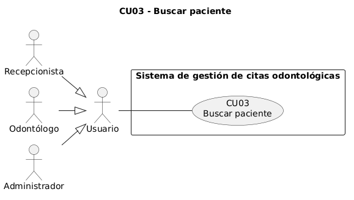 | |
|---|---|
| Caso de uso | CU03: Buscar paciente |
| Propósito | Ubicar rápidamente a un paciente por nombre, apellido o CI (requisito «búsqueda por nombre o CI»). |
| Descripción | Cualquier perfil escribe un texto en el buscador de «Pacientes». El sistema separa el texto en palabras y devuelve los pacientes cuyo nombre, apellido o CI contienen cada palabra, sin distinguir mayúsculas, ordenados por apellido y nombre y paginados. |
| Actor(es) | Usuario (Recepcionista, Odontólogo, Administrador) |
| Actor iniciador | Usuario |
| Paquete y ciclo | P1 Acceso y pacientes · Ciclo 1 |
| Relaciones | Ninguna relación «include» o «extend». El buscador del formulario de reserva usa el mismo servicio, pero no se modela «include» porque la reserva también puede empezar con el paciente ya elegido desde su ficha (CU07, A1). |
| Precondición | • Perfil elegido (CU01). |
| Flujo principal | 1. El usuario entra a «Pacientes». 2. El sistema muestra los pacientes paginados. 3. El usuario escribe nombre, apellido o CI en el buscador. 4. El sistema filtra y muestra las coincidencias. 5. El usuario abre un paciente (continúa en CU15). |
| Flujos alternativos | A1. El usuario cambia de página con la paginación. |
| Postcondición | • No se modifican datos. |
| Excepciones | E1. Sin coincidencias: «Ningún paciente coincide con «texto».» E2. Error de red o del servidor: aviso con el mensaje y el botón «Reintentar». |
| Clases de análisis previstas | Vista: Vpaciente Control: Cpaciente Entidad: Epaciente |

#### CU04 Gestionar odontólogos

<!-- ficha -->
| 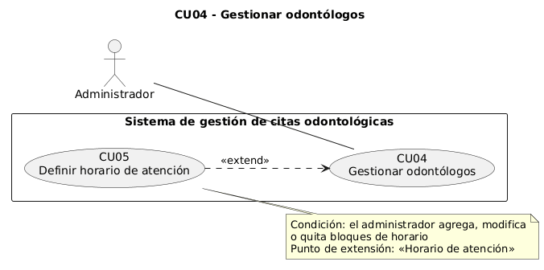 | |
|---|---|
| Caso de uso | CU04: Gestionar odontólogos |
| Propósito | Mantener el catálogo de odontólogos con su especialidad y estado, base de la agenda. |
| Descripción | El administrador registra, edita, activa o desactiva y elimina odontólogos. Un odontólogo inactivo no aparece en los selectores y no recibe nuevas citas; uno que ya tiene citas no se elimina, se desactiva. |
| Actor(es) | Administrador |
| Actor iniciador | Administrador |
| Paquete y ciclo | P2 Odontólogos y tratamientos · Ciclo 1 |
| Relaciones | Extendido por CU05 Definir horario de atención («extend»): el mismo formulario incorpora el horario cuando el administrador agrega, modifica o quita bloques. |
| Precondición | • Perfil Administrador (CU01). |
| Flujo principal | 1. El administrador entra a «Odontólogos». 2. El sistema lista los odontólogos con filtros por texto, especialidad y estado («Activos», «Inactivos»). 3. El administrador pulsa «Nuevo odontólogo». 4. Completa «Nombre completo» y «Especialidad» y deja encendido «Activo». 5. El sistema valida, registra el odontólogo y muestra «Odontólogo registrado». |
| Flujos alternativos | A1. Editar: desde la lista abre el odontólogo, cambia los datos y guarda; el sistema muestra «Odontólogo actualizado». A2. Desactivar: apaga «Activo» y guarda. A3. Eliminar: pulsa «Eliminar» y confirma «¿Eliminar odontólogo?». |
| Postcondición | • La fila de Odontologo queda registrada o actualizada. • Si está inactivo, no aparece en la reserva ni en el selector de perfil. |
| Excepciones | E1. Datos no válidos: 400 VALIDACION, por ejemplo «El nombre es obligatorio». E2. Odontólogo con citas: 409 EN_USO «No se puede eliminar al odontólogo porque tiene N cita(s) registrada(s); desactívalo con activo=false». E3. Odontólogo inexistente: 404 «No existe el odontólogo con id N». |
| Clases de análisis previstas | Vista: Vodontologo Control: Codontologo Entidad: Eodontologo |

#### CU05 Definir horario de atención

<!-- ficha -->
| 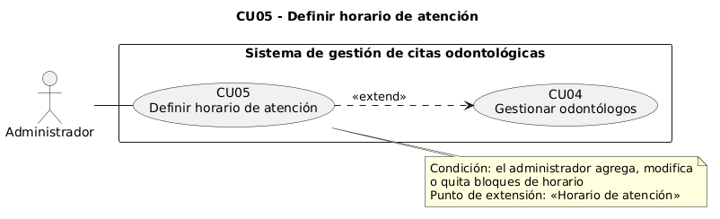 | |
|---|---|
| Caso de uso | CU05: Definir horario de atención |
| Propósito | Registrar los bloques de atención de cada odontólogo, que limitan la agenda (regla «sin citas fuera de horario»). |
| Descripción | En el formulario del odontólogo, el administrador agrega, modifica o quita bloques con día de la semana, hora de inicio y hora de fin en hora local de La Paz. El sistema rechaza horas invertidas y bloques solapados el mismo día, admite hasta 21 bloques y reemplaza todos los bloques del odontólogo en una transacción. |
| Actor(es) | Administrador |
| Actor iniciador | Administrador |
| Paquete y ciclo | P2 Odontólogos y tratamientos · Ciclo 1 |
| Relaciones | «extend» hacia CU04 Gestionar odontólogos. Condición: el administrador agrega, modifica o quita bloques. Punto de extensión: sección «Horario de atención» del formulario. |
| Precondición | • Perfil Administrador (CU01). • Formulario de alta o edición del odontólogo abierto (CU04). |
| Flujo principal | 1. En la sección «Horario de atención» el administrador agrega un bloque. 2. El sistema añade una fila con día, hora de inicio y hora de fin. 3. El administrador ajusta los valores y guarda el odontólogo. 4. El sistema valida el formato HH:MM, que el inicio sea anterior al fin, que no haya solapes el mismo día y que no pasen de 21 bloques. 5. El sistema borra los bloques anteriores y crea los nuevos en una transacción y muestra «Odontólogo actualizado». |
| Flujos alternativos | A1. Quitar un bloque antes de guardar. A2. Guardar sin bloques: se acepta, pero toda reserva para ese odontólogo será rechazada por FUERA_DE_HORARIO. |
| Postcondición | • HorarioAtencion contiene exactamente los bloques enviados, únicos por (odontologoId, diaSemana, horaInicio). |
| Excepciones | E1. Hora de inicio igual o posterior a la de fin: «lunes: la hora de inicio debe ser anterior a la de fin.» en el formulario; en la API, 400 «La hora de inicio debe ser anterior a la hora de fin». E2. Bloques solapados: «lunes: los bloques 08:00–12:00 y 11:00–14:00 se solapan.» en el formulario; en la API, 400 «Los bloques de horario i y j se solapan el mismo día». |
| Clases de análisis previstas | Vista: Vodontologo Control: Codontologo Entidad: Eodontologo, Ehorario_atencion |

#### CU06 Gestionar tratamientos

<!-- ficha -->
| 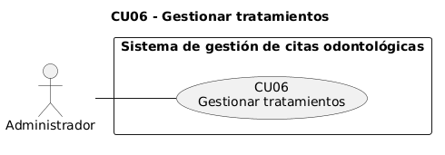 | |
|---|---|
| Caso de uso | CU06: Gestionar tratamientos |
| Propósito | Mantener el catálogo de tratamientos con la duración que determina la hora de fin de cada cita y su precio de referencia. |
| Descripción | El administrador registra, edita, desactiva y elimina tratamientos con nombre único, descripción opcional, duración de 5 a 480 minutos y precio con hasta dos decimales. Un tratamiento inactivo no se puede agendar; uno con citas no se elimina. |
| Actor(es) | Administrador |
| Actor iniciador | Administrador |
| Paquete y ciclo | P2 Odontólogos y tratamientos · Ciclo 1 |
| Relaciones | Ninguna relación «include» o «extend». |
| Precondición | • Perfil Administrador (CU01). |
| Flujo principal | 1. El administrador entra a «Tratamientos». 2. El sistema lista los tratamientos con filtro por texto y estado. 3. El administrador pulsa «Nuevo tratamiento» y completa «Nombre», «Descripción», «Duración (minutos)», «Precio (Bs)» y «Activo». 4. El sistema valida los datos y que no exista otro tratamiento con el mismo nombre (sin distinguir mayúsculas). 5. El sistema registra el tratamiento y muestra «Tratamiento registrado». |
| Flujos alternativos | A1. Editar: el sistema muestra «Tratamiento actualizado». A2. Desactivar: apaga «Activo». A3. Eliminar: confirma «¿Eliminar tratamiento?». |
| Postcondición | • La fila de Tratamiento queda registrada o actualizada con nombre único. • Cambiar la duración no modifica las citas ya agendadas, que conservan su hora de fin. |
| Excepciones | E1. Duración o precio no válidos: 400, por ejemplo «La duración mínima es 5 minutos» o «El precio debe ser un número positivo con hasta 2 decimales». E2. Nombre repetido: 409 NOMBRE_DUPLICADO «Ya existe un tratamiento llamado "…"». E3. Tratamiento con citas: 409 EN_USO «No se puede eliminar el tratamiento porque tiene N cita(s); desactívalo con activo=false». |
| Clases de análisis previstas | Vista: Vtratamiento Control: Ctratamiento Entidad: Etratamiento |

#### CU07 Reservar cita

<!-- ficha -->
| 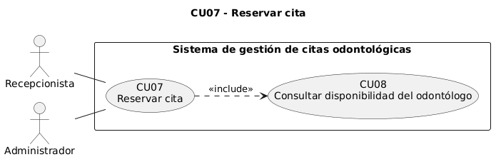 | |
|---|---|
| Caso de uso | CU07: Reservar cita |
| Propósito | Agendar una cita sin choques, sin fechas pasadas y dentro del horario del odontólogo (reglas de la historia #1). Es el caso de uso núcleo del sistema. |
| Descripción | La recepcionista elige paciente, odontólogo activo, tratamiento activo, fecha y hora de inicio. El sistema calcula la hora de fin con la duración del tratamiento y, en una transacción con bloqueo de la agenda del odontólogo, comprueba que la cita no esté en el pasado, que quepa completa en un bloque del horario y que no se cruce con otra cita no cancelada del mismo odontólogo. La cita queda PENDIENTE. |
| Actor(es) | Recepcionista, Administrador |
| Actor iniciador | Recepcionista |
| Paquete y ciclo | P3 Agenda de citas · Ciclo 1 |
| Relaciones | «include» hacia CU08 Consultar disponibilidad del odontólogo: al elegir odontólogo y fecha el formulario siempre muestra los bloques del día y las horas reservadas. |
| Precondición | • Perfil Recepcionista o Administrador (CU01). • Paciente registrado (CU02). • Odontólogo activo con horario (CU04, CU05) y tratamiento activo (CU06). |
| Flujo principal | 1. La recepcionista entra a «Nueva cita». 2. El sistema muestra «Buscar paciente», «Odontólogo», «Tratamiento», la fecha (hoy por defecto), la hora y «Motivo», con solo odontólogos y tratamientos activos. 3. La recepcionista busca y elige al paciente. 4. Elige odontólogo, tratamiento y fecha. 5. El sistema muestra el horario del día y las horas ya reservadas (CU08). 6. La recepcionista elige la hora de inicio y confirma. 7. El sistema valida los datos; en una transacción bloquea la agenda del odontólogo, verifica paciente, odontólogo y tratamiento, calcula la hora de fin y comprueba pasado, horario y choques. 8. El sistema registra la cita PENDIENTE, muestra «Cita reservada: fecha de hh:mm a hh:mm» y abre el detalle de la cita. |
| Flujos alternativos | A1. Desde la ficha del paciente con «Nueva cita»: el paciente llega preseleccionado y se omite el paso 3. A2. La recepcionista pulsa «Cambiar» para elegir otro paciente. A3. Una cita que empieza justo cuando termina otra se acepta, porque los intervalos son semiabiertos [inicio, fin). |
| Postcondición | • Existe una nueva fila en Cita con estado PENDIENTE, inicio y fin = inicio + duración del tratamiento. • El intervalo queda ocupado para el odontólogo. |
| Excepciones | E1. Faltan datos: «Elige un paciente», «Elige un odontólogo», «Elige un tratamiento», «Elige la hora». E2. Datos no válidos: 400 VALIDACION con el mensaje en el campo. E3. Paciente, odontólogo o tratamiento inexistente: 404 «No existe el paciente con id N» (o el odontólogo o tratamiento). E4. Odontólogo o tratamiento inactivo: 422 INACTIVO «El odontólogo … está inactivo y no puede recibir citas». E5. Fecha y hora pasadas: 422 CITA_EN_PASADO «No se puede agendar una cita en el pasado (fecha hora, hora de La Paz)». E6. No cabe en el horario: 422 FUERA_DE_HORARIO «La cita de hh:mm a hh:mm (N min) no cabe en el horario de atención: …». E7. Choque: 409 CHOQUE_HORARIO «El odontólogo ya tiene una cita el fecha de hh:mm a hh:mm que se cruza con este horario». |
| Clases de análisis previstas | Vista: Vcita Control: Ccita Entidad: Epaciente, Eodontologo, Ehorario_atencion, Etratamiento, Ecita |

#### CU08 Consultar disponibilidad del odontólogo

<!-- ficha -->
| 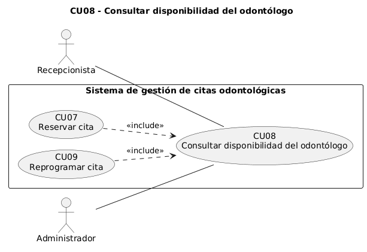 | |
|---|---|
| Caso de uso | CU08: Consultar disponibilidad del odontólogo |
| Propósito | Mostrar a la recepcionista qué horas puede ofrecer antes de confirmar una reserva o una reprogramación. |
| Descripción | Al elegir odontólogo y fecha, el sistema muestra los bloques del horario de ese día de la semana y las horas ya reservadas por citas PENDIENTE o CONFIRMADA. Es informativo: la comprobación que decide es la de CU07 y CU09. |
| Actor(es) | Recepcionista, Administrador |
| Actor iniciador | Recepcionista |
| Paquete y ciclo | P3 Agenda de citas · Ciclo 1 |
| Relaciones | Incluido por CU07 Reservar cita y CU09 Reprogramar cita («include»). |
| Precondición | • Odontólogo y fecha elegidos en el formulario de CU07 o CU09. |
| Flujo principal | 1. El actor elige odontólogo y fecha. 2. El sistema toma los bloques del odontólogo para ese día de la semana. 3. El sistema consulta las citas PENDIENTE y CONFIRMADA del odontólogo en esa fecha. 4. El sistema muestra «día: horario de nombre», los bloques y «Horas ya reservadas». |
| Flujos alternativos | A1. En la reprogramación, la propia cita no se muestra como hora reservada. |
| Postcondición | • No se modifican datos. |
| Excepciones | E1. El odontólogo no atiende ese día: «No atiende este día.» |
| Clases de análisis previstas | Vista: Vcita Control: Ccita Entidad: Eodontologo, Ehorario_atencion, Ecita |

### 4.3.2 Ciclo 2

#### CU09 Reprogramar cita

<!-- ficha -->
| 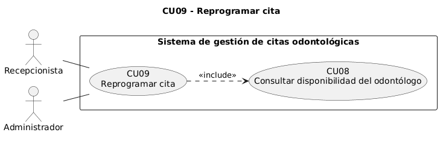 | |
|---|---|
| Caso de uso | CU09: Reprogramar cita |
| Propósito | Mover una cita activa a otra fecha, hora, odontólogo o tratamiento sin violar las reglas de agenda y liberando el horario anterior. |
| Descripción | Sobre una cita PENDIENTE o CONFIRMADA, la recepcionista cambia fecha, hora, odontólogo o tratamiento. El sistema recalcula la hora de fin y aplica las mismas reglas que CU07 excluyendo la propia cita, por lo que puede moverse dentro de su propio horario. |
| Actor(es) | Recepcionista, Administrador |
| Actor iniciador | Recepcionista |
| Paquete y ciclo | P3 Agenda de citas · Ciclo 2 |
| Relaciones | «include» hacia CU08 Consultar disponibilidad del odontólogo: el diálogo muestra siempre el horario del día y las horas reservadas. |
| Precondición | • Perfil Recepcionista o Administrador (CU01). • Cita PENDIENTE o CONFIRMADA (CU07). |
| Flujo principal | 1. En «Agenda de citas» o en el detalle, la recepcionista pulsa «Reprogramar». 2. El sistema abre «Reprogramar cita» con «Fecha», «Hora de inicio», «Odontólogo», «Tratamiento» y «Motivo» precargados. 3. La recepcionista modifica los datos. 4. El sistema muestra la disponibilidad (CU08). 5. La recepcionista confirma. 6. El sistema, en una transacción con bloqueo de la agenda, valida las reglas y actualiza la cita. 7. El sistema muestra «Cita reprogramada para el fecha a las hh:mm». |
| Flujos alternativos | A1. Solo cambia el motivo: se actualiza sin revalidar la agenda. A2. Mover la cita dentro de su propio intervalo: se acepta porque la propia cita se excluye de la búsqueda de choques. |
| Postcondición | • La cita conserva su id y estado, con el nuevo inicio y el fin recalculado. • El intervalo anterior queda libre. |
| Excepciones | E1. Cita cancelada o atendida: 422 ESTADO_INVALIDO «No se puede reprogramar una cita cancelada» o «… ya atendida». E2. Choque: 409 CHOQUE_HORARIO. E3. Pasado o fuera de horario: 422 CITA_EN_PASADO o FUERA_DE_HORARIO con el mismo mensaje que CU07. E4. Cita inexistente: 404 «No existe la cita con id N». |
| Clases de análisis previstas | Vista: Vcita Control: Ccita Entidad: Eodontologo, Ehorario_atencion, Etratamiento, Ecita |

#### CU10 Cancelar cita

<!-- ficha -->
| 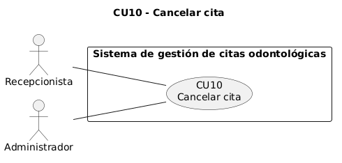 | |
|---|---|
| Caso de uso | CU10: Cancelar cita |
| Propósito | Anular una cita activa dejando libre su horario (regla «cancelar libera el horario»). |
| Descripción | La recepcionista cancela una cita PENDIENTE o CONFIRMADA con un motivo opcional. La cita no se borra: queda CANCELADA y la búsqueda de choques la ignora, por lo que el horario vuelve a estar disponible. |
| Actor(es) | Recepcionista, Administrador |
| Actor iniciador | Recepcionista |
| Paquete y ciclo | P3 Agenda de citas · Ciclo 2 |
| Relaciones | Ninguna relación «include» o «extend». |
| Precondición | • Perfil Recepcionista o Administrador (CU01). • Cita PENDIENTE o CONFIRMADA (CU07). |
| Flujo principal | 1. La recepcionista pulsa «Cancelar» en la cita. 2. El sistema muestra «¿Cancelar la cita?» con el campo «Motivo de la cancelación» (opcional). 3. La recepcionista confirma. 4. El sistema cambia el estado a CANCELADA y guarda el motivo. 5. El sistema muestra «Cita cancelada; el horario quedó libre». |
| Flujos alternativos | A1. La cita ya estaba cancelada: el sistema la devuelve sin cambios. |
| Postcondición | • Cita con estado CANCELADA y motivoCancelacion registrado. • Otra cita puede ocupar ese intervalo. |
| Excepciones | E1. Cita atendida: 422 ESTADO_INVALIDO «La cita ya fue atendida y no puede cambiar de estado». E2. Cita inexistente: 404 «No existe la cita con id N». |
| Clases de análisis previstas | Vista: Vcita Control: Ccita Entidad: Ecita |

#### CU11 Confirmar cita

<!-- ficha -->
| 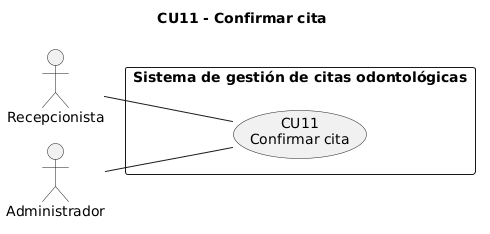 | |
|---|---|
| Caso de uso | CU11: Confirmar cita |
| Propósito | Registrar que el paciente confirmó su asistencia. |
| Descripción | La recepcionista pasa una cita PENDIENTE a CONFIRMADA, o la devuelve a PENDIENTE. El sistema solo admite las transiciones definidas: PENDIENTE y CONFIRMADA pueden alternarse, y CANCELADA y ATENDIDA son finales. |
| Actor(es) | Recepcionista, Administrador |
| Actor iniciador | Recepcionista |
| Paquete y ciclo | P3 Agenda de citas · Ciclo 2 |
| Relaciones | Ninguna relación «include» o «extend». |
| Precondición | • Perfil Recepcionista o Administrador (CU01). • Cita PENDIENTE (CU07). |
| Flujo principal | 1. La recepcionista pulsa «Confirmar» en la cita. 2. El sistema verifica que la transición esté permitida y cambia el estado a CONFIRMADA. 3. El sistema muestra «Cita confirmada». |
| Flujos alternativos | A1. En una cita CONFIRMADA pulsa «Marcar pendiente»; el sistema muestra «Cita marcada como pendiente». |
| Postcondición | • La cita queda CONFIRMADA (o PENDIENTE en A1). |
| Excepciones | E1. Cita cancelada: 422 ESTADO_INVALIDO «La cita está cancelada y no puede reactivarse; agenda una nueva cita». E2. Cita atendida: 422 ESTADO_INVALIDO «La cita ya fue atendida y no puede cambiar de estado». |
| Clases de análisis previstas | Vista: Vcita Control: Ccita Entidad: Ecita |

#### CU12 Consultar agenda de citas

<!-- ficha -->
| 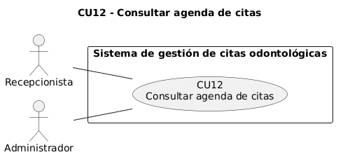 | |
|---|---|
| Caso de uso | CU12: Consultar agenda de citas |
| Propósito | Ver y filtrar las citas del consultorio (requisito «listados filtrables»). |
| Descripción | La recepcionista consulta las citas de un rango de fechas, por defecto la semana actual de lunes a domingo, y las filtra por odontólogo, estado y texto del paciente. Desde cada fila accede a confirmar, reprogramar o cancelar. |
| Actor(es) | Recepcionista, Administrador |
| Actor iniciador | Recepcionista |
| Paquete y ciclo | P4 Atención y seguimiento · Ciclo 2 |
| Relaciones | Ninguna relación «include» o «extend». |
| Precondición | • Perfil Recepcionista o Administrador (CU01). |
| Flujo principal | 1. La recepcionista entra a «Agenda de citas». 2. El sistema muestra las citas de la semana actual ordenadas por hora de inicio. 3. La recepcionista ajusta «Desde», «Hasta», «Odontólogo», los estados o el texto de «Paciente». 4. El sistema muestra las citas que cumplen los filtros con paciente, odontólogo, tratamiento, horario y estado. |
| Flujos alternativos | A1. Navegar con «Semana anterior», «Esta semana» y «Semana siguiente». A2. Desde una fila, continuar en CU09, CU10 o CU11. |
| Postcondición | • No se modifican datos. |
| Excepciones | E1. Rango invertido: 400 «desde no puede ser posterior a hasta». E2. Sin resultados: «Ninguna cita coincide con los filtros en este rango de fechas.» |
| Clases de análisis previstas | Vista: Vagenda Control: Ccita Entidad: Ecita, Epaciente, Eodontologo, Etratamiento |

#### CU13 Consultar agenda del día

<!-- ficha -->
| 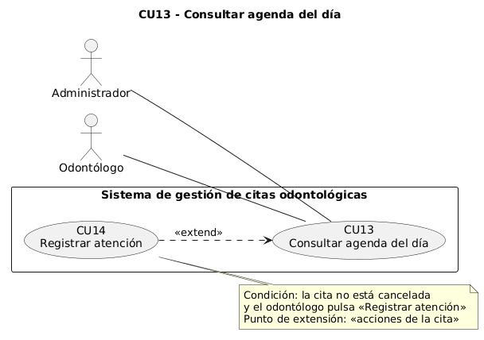 | |
|---|---|
| Caso de uso | CU13: Consultar agenda del día |
| Propósito | Que el odontólogo vea sus pacientes del día (requisito «ve su agenda del día»). |
| Descripción | El sistema muestra las citas de un odontólogo en una fecha; por defecto, el odontólogo del perfil y la fecha de hoy. Cada fila muestra paciente, tratamiento, horario y estado y, si el perfil lo permite, el botón de atención. |
| Actor(es) | Odontólogo, Administrador |
| Actor iniciador | Odontólogo |
| Paquete y ciclo | P4 Atención y seguimiento · Ciclo 2 |
| Relaciones | Extendido por CU14 Registrar atención («extend»). |
| Precondición | • Perfil Odontólogo o Administrador (CU01). |
| Flujo principal | 1. El odontólogo entra a «Mi agenda del día». 2. El sistema toma el odontólogo del perfil y la fecha de hoy. 3. El sistema consulta y muestra sus citas del día en orden de hora. |
| Flujos alternativos | A1. Cambiar el odontólogo o la fecha en los selectores (el administrador elige el odontólogo). A2. Pulsar «Registrar atención» en una cita (continúa en CU14). |
| Postcondición | • No se modifican datos. |
| Excepciones | E1. No hay odontólogo elegido: «Elige un odontólogo». E2. No hay citas en la fecha: «Sin citas». |
| Clases de análisis previstas | Vista: Vagenda Control: Ccita Entidad: Ecita, Eodontologo |

#### CU14 Registrar atención

<!-- ficha -->
| 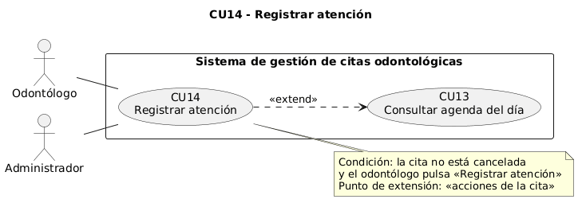 | |
|---|---|
| Caso de uso | CU14: Registrar atención |
| Propósito | Dejar constancia de lo que se hizo en cada cita (requisito «saber qué atenciones se hicieron»). Es el caso de uso núcleo del ciclo 2. |
| Descripción | El odontólogo registra diagnóstico, tratamiento realizado y observaciones de una cita no cancelada. En una transacción, el sistema crea la atención, única por cita, y marca la cita como ATENDIDA. Después puede corregir la atención. |
| Actor(es) | Odontólogo, Administrador |
| Actor iniciador | Odontólogo |
| Paquete y ciclo | P4 Atención y seguimiento · Ciclo 2 |
| Relaciones | «extend» hacia CU13 Consultar agenda del día. Condición: la cita no está cancelada y el odontólogo pulsa «Registrar atención». Punto de extensión: acciones de la cita. |
| Precondición | • Perfil Odontólogo o Administrador (CU01). • Cita existente no cancelada (CU07). |
| Flujo principal | 1. En «Mi agenda del día» (CU13) o en el detalle de la cita, el odontólogo pulsa «Registrar atención». 2. El sistema abre el diálogo con «Diagnóstico», «Tratamiento realizado» (precargado con el tratamiento de la cita) y «Observaciones». 3. El odontólogo completa los campos y pulsa «Registrar y marcar atendida». 4. El sistema verifica que haya al menos un campo con texto. 5. En una transacción, el sistema verifica que la cita exista, no esté cancelada y no tenga atención, crea la atención y cambia la cita a ATENDIDA. 6. El sistema muestra «Atención registrada: la cita quedó atendida». |
| Flujos alternativos | A1. Corregir: en una cita con atención pulsa «Editar atención», cambia los campos y pulsa «Guardar cambios»; el sistema actualiza la atención y muestra «Atención actualizada». |
| Postcondición | • Existe una fila en Atencion con el citaId de la cita (único). • La cita queda ATENDIDA y ya no admite cambios de estado, reprogramación ni eliminación. |
| Excepciones | E1. Los tres campos vacíos: «Completa al menos uno de los tres campos.» E2. Cita inexistente: 404 «No existe la cita con id N». E3. Cita cancelada: 422 ESTADO_INVALIDO «No se puede registrar la atención de una cita cancelada». E4. Atención ya registrada: 409 CONFLICTO «La cita ya tiene una atención registrada; usa PATCH para modificarla». E5. En A1, la cita no tiene atención: 404 «La cita todavía no tiene una atención registrada». |
| Clases de análisis previstas | Vista: Vatencion Control: Catencion Entidad: Ecita, Eatencion |

#### CU15 Consultar historial del paciente

<!-- ficha -->
| 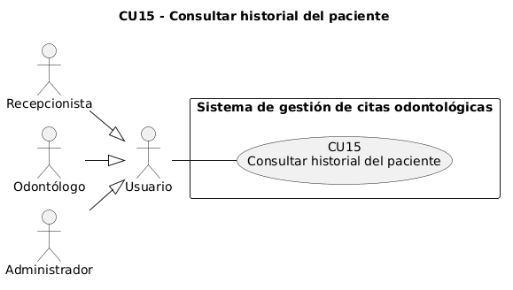 | |
|---|---|
| Caso de uso | CU15: Consultar historial del paciente |
| Propósito | Ver en un solo lugar los datos del paciente y todas sus citas y atenciones (requisito «historial»). |
| Descripción | Desde la lista de pacientes, cualquier perfil abre la ficha del paciente. El sistema muestra sus datos y el historial de citas de la más reciente a la más antigua, con odontólogo, tratamiento, estado y atención, filtrable por estado. |
| Actor(es) | Usuario (Recepcionista, Odontólogo, Administrador) |
| Actor iniciador | Usuario |
| Paquete y ciclo | P4 Atención y seguimiento · Ciclo 2 |
| Relaciones | Ninguna relación «include» o «extend». |
| Precondición | • Perfil elegido (CU01). • Paciente registrado (CU02). |
| Flujo principal | 1. El usuario abre un paciente desde «Pacientes» (CU03). 2. El sistema muestra «Ficha del paciente» con teléfono, correo, fecha de nacimiento, número de citas y fecha de registro. 3. El sistema muestra el historial de citas con su atención. 4. El usuario filtra por estado. |
| Flujos alternativos | A1. Con perfil Recepcionista o Administrador, desde la ficha puede pulsar «Nueva cita» (CU07), «Editar» o «Eliminar» (CU02). |
| Postcondición | • No se modifican datos. |
| Excepciones | E1. Paciente inexistente: 404 «No existe el paciente con id N». E2. Sin citas: «Este paciente aún no tiene citas.» |
| Clases de análisis previstas | Vista: Vpaciente Control: Cpaciente Entidad: Epaciente, Ecita, Eatencion |

#### CU16 Consultar tablero

<!-- ficha -->
|  | |
|---|---|
| Caso de uso | CU16: Consultar tablero |
| Propósito | Dar al dueño una visión de la operación (requisito «tablero»). |
| Descripción | El sistema calcula, para una fecha de referencia (hoy por defecto), las citas del día con su conteo por estado, las citas no canceladas de la semana de lunes a domingo agrupadas por odontólogo activo y los pacientes registrados en el mes. |
| Actor(es) | Recepcionista, Administrador |
| Actor iniciador | Administrador |
| Paquete y ciclo | P4 Atención y seguimiento · Ciclo 2 |
| Relaciones | Ninguna relación «include» o «extend». |
| Precondición | • Perfil Recepcionista o Administrador (CU01). |
| Flujo principal | 1. El actor entra a «Tablero». 2. El sistema consulta citas del día, citas de la semana, odontólogos activos y pacientes del mes en paralelo. 3. El sistema muestra los indicadores «Citas del día», «Citas de la semana» y «Pacientes nuevos del mes» con su detalle. |
| Flujos alternativos | A1. El actor cambia la «Fecha de referencia» y el sistema recalcula los tres indicadores. |
| Postcondición | • No se modifican datos. |
| Excepciones | E1. Fecha no válida: 400 VALIDACION. E2. Sin citas en el día: «Sin citas hoy». |
| Clases de análisis previstas | Vista: Vtablero Control: Ctablero Entidad: Ecita, Eodontologo, Epaciente |

## 4.4 Prototipar la Interfaz de Usuario

Los prototipos son capturas de las pantallas implementadas, tomadas con el navegador en modo automático sobre la aplicación compilada (`next build` y `next start`) y los datos de prueba del seed. El script `docs/generador/capturas.mjs` solo abre páginas y diálogos; no envía formularios. La interfaz se generó con v0 y se integró con la API real.

### 4.4.1 Ciclo 1

#### CU01 Seleccionar perfil

.")

#### CU02 Gestionar pacientes

.")

#### CU03 Buscar paciente

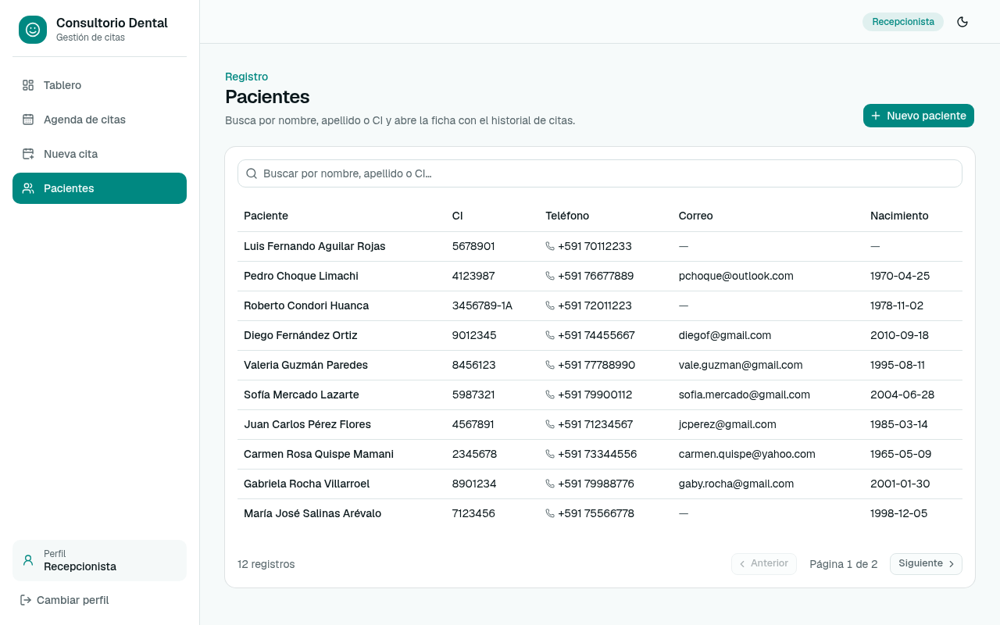

#### CU04 Gestionar odontólogos

La misma pantalla de edición del odontólogo cubre CU04 y su extensión CU05.

#### CU05 Definir horario de atención

.")

#### CU06 Gestionar tratamientos

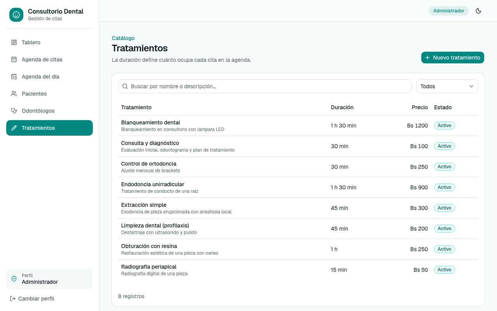

#### CU07 Reservar cita

El formulario de reserva incluye la disponibilidad del odontólogo (CU08), visible al elegir odontólogo y fecha.

#### CU08 Consultar disponibilidad del odontólogo

.")

### 4.4.2 Ciclo 2

#### CU09 Reprogramar cita

.")

#### CU10 Cancelar cita

.")

#### CU11 Confirmar cita

.")

#### CU12 Consultar agenda de citas

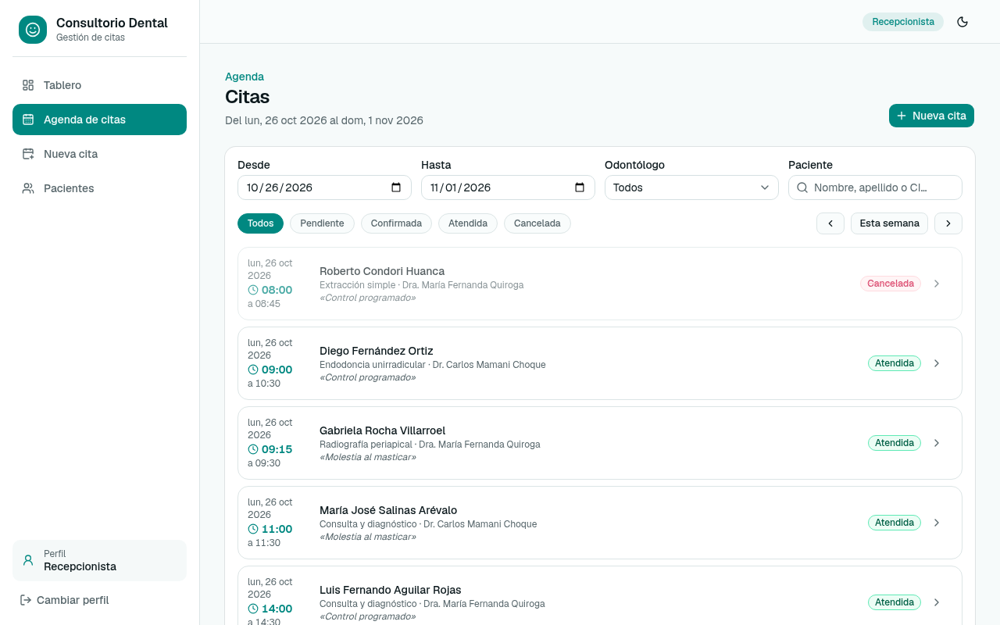

#### CU13 Consultar agenda del día

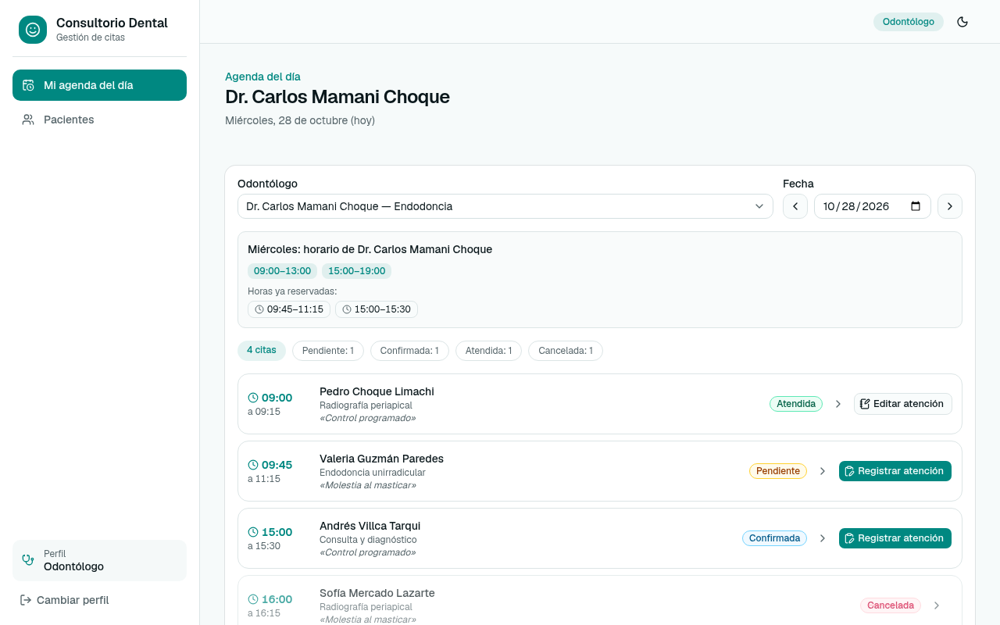

#### CU14 Registrar atención

.")

#### CU15 Consultar historial del paciente

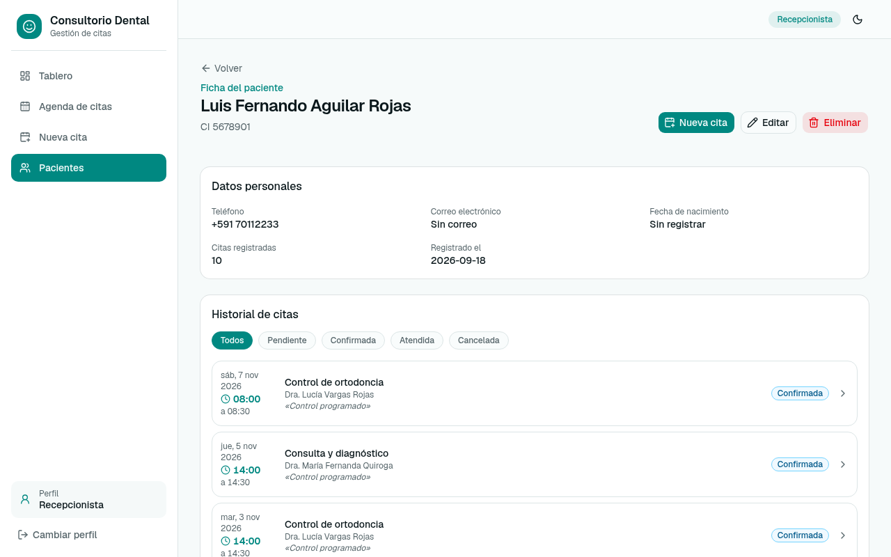

#### CU16 Consultar tablero

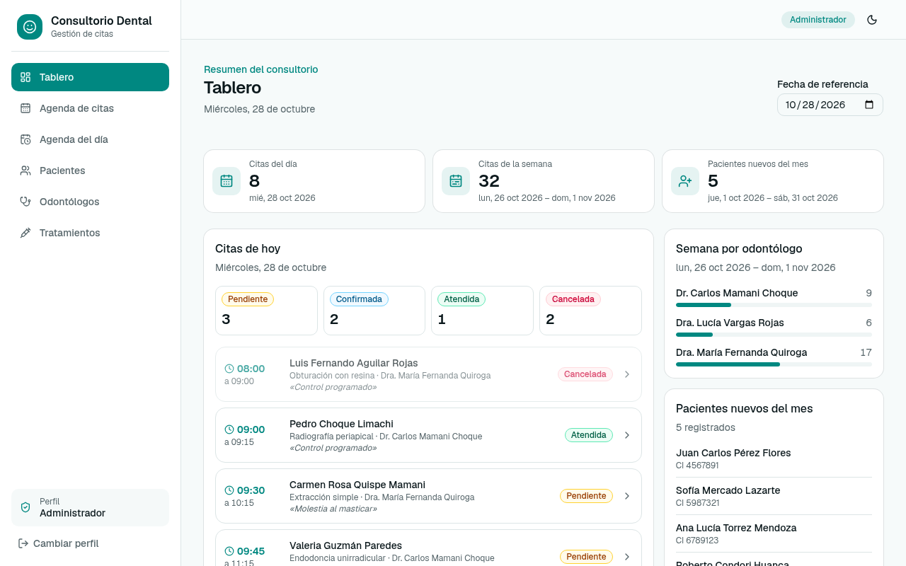

## 4.5 Estructurar Modelos de Caso de Uso

Iniciar sesión no existe como tal; elegir perfil (CU01) es una precondición de los demás casos de uso y no se modela como «include». Las relaciones de cada ciclo están en `docs/generador/casos_uso_puml.mjs`, que genera los diagramas desde el catálogo, y coinciden con la fila «Relaciones» de cada ficha.

### 4.5.1 Ciclo 1

| Relación | Origen | Destino | Justificación |
|---|---|---|---|
| Generalización | Recepcionista, Odontólogo, Administrador | Usuario | Los tres perfiles comparten CU01 y CU03. |
| «extend» | CU05 Definir horario de atención | CU04 Gestionar odontólogos | El horario se agrega o modifica opcionalmente en el formulario del odontólogo; la API acepta odontólogos sin bloques. |
| «include» | CU07 Reservar cita | CU08 Consultar disponibilidad del odontólogo | El formulario muestra siempre el horario del día y las horas reservadas al elegir odontólogo y fecha. |

.")

### 4.5.2 Ciclo 2

| Relación | Origen | Destino | Justificación |
|---|---|---|---|
| Generalización | Recepcionista, Odontólogo, Administrador | Usuario | Los tres perfiles comparten CU15. |
| «include» | CU09 Reprogramar cita | CU08 Consultar disponibilidad del odontólogo | El diálogo de reprogramación reutiliza el mismo componente de disponibilidad, excluyendo la propia cita. |
| «extend» | CU14 Registrar atención | CU13 Consultar agenda del día | Desde cada cita no cancelada de la agenda del día el odontólogo puede, si lo decide, registrar la atención. |

. CU08 se muestra como caso de uso del ciclo 1 incluido por CU09.")
