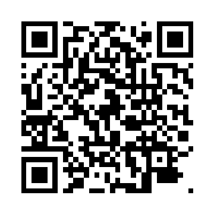

# 11. BIBLIOGRAFÍA

Fuentes internas del proyecto:

- samm-gabriel. (2026). *Historia de usuario #1: Sistema de gestión de citas para un consultorio odontológico* [Issue]. GitHub. https://github.com/samm-gabriel/gestion-citas-dental/issues/1
- samm-gabriel. (2026). *Plan de sub-historias* (docs/plan.md). Repositorio gestion-citas-dental.
- samm-gabriel. (2026). *API de gestión de citas odontológicas, contrato OpenAPI 3.1.0* (docs/api/openapi.yaml). Repositorio gestion-citas-dental.

Documentación y referencias externas:

- Jacobson, I., Booch, G. y Rumbaugh, J. (1999). *The Unified Software Development Process*. Addison-Wesley.
- Mermaid. (s. f.). *Entity Relationship Diagrams*. https://mermaid.js.org/syntax/entityRelationshipDiagram.html
- Neon. (s. f.). *Neon documentation*. https://neon.tech/docs
- OpenAPI Initiative. (2021). *OpenAPI Specification v3.1.0*. https://spec.openapis.org/oas/v3.1.0
- OWASP Foundation. (s. f.). *Password Storage Cheat Sheet*. https://cheatsheetseries.owasp.org/cheatsheets/Password_Storage_Cheat_Sheet.html
- PlantUML. (s. f.). *PlantUML language reference*. https://plantuml.com
- Prisma Data. (s. f.). *Prisma ORM documentation*. https://www.prisma.io/docs
- The PostgreSQL Global Development Group. (s. f.). *PostgreSQL documentation*. https://www.postgresql.org/docs/
- Vercel. (s. f.). *Next.js documentation*. https://nextjs.org/docs
- Vitest. (s. f.). *Vitest documentation*. https://vitest.dev
- W3C. (2023). *Web Content Accessibility Guidelines (WCAG) 2.2*. https://www.w3.org/TR/WCAG22/
- Zod. (s. f.). *Zod documentation*. https://zod.dev

## 11.1 Acceso al Repositorio

El código fuente, el contrato de la API, los diagramas y este documento están en el repositorio https://github.com/samm-gabriel/gestion-citas-dental (rama `main`). El sistema aún no está desplegado; la URL de producción se registrará en el issue #10.

