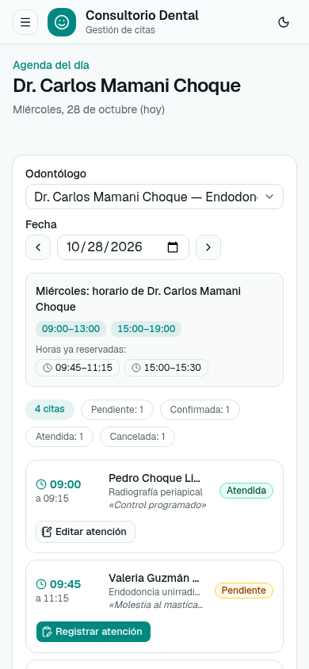

# 12. ANEXOS

## 12.1 Acceso de prueba

El sistema no usa usuarios ni contraseñas, por lo que no hay credenciales de prueba: en la pantalla inicial se elige el perfil Recepcionista, Odontólogo o Administrador y, para Odontólogo, el nombre del profesional. Los datos de prueba los carga `npm run db:seed`: 12 pacientes, 4 odontólogos con 20 bloques de horario, 8 tratamientos, 114 citas alrededor de la fecha de ejecución y 46 atenciones.

## 12.2 Rutas de la API

| Ruta | Métodos | Uso (CU) |
|---|---|---|
| `/api/pacientes` | GET, POST | Listar y buscar (CU03), registrar (CU02). |
| `/api/pacientes/{id}` | GET, PATCH, DELETE | Ficha, editar y eliminar (CU02, CU15). |
| `/api/pacientes/{id}/citas` | GET | Historial del paciente, filtrable por estado (CU15). |
| `/api/odontologos` | GET, POST | Listar con filtros y registrar con horarios (CU01, CU04, CU05). |
| `/api/odontologos/{id}` | GET, PATCH, DELETE | Ver, editar (reemplaza horarios) y eliminar (CU04, CU05). |
| `/api/tratamientos` | GET, POST | Listar y registrar (CU06). |
| `/api/tratamientos/{id}` | GET, PATCH, DELETE | Ver, editar y eliminar (CU06). |
| `/api/citas` | GET, POST | Agenda filtrable y disponibilidad (CU08, CU12, CU13); reservar (CU07). |
| `/api/citas/{id}` | GET, PATCH, DELETE | Detalle, reprogramar (CU09) y eliminar una cita no atendida (solo API). |
| `/api/citas/{id}/cancelar` | POST | Cancelar (CU10). |
| `/api/citas/{id}/estado` | PATCH | Confirmar o volver a pendiente (CU11). |
| `/api/citas/{id}/atencion` | GET, POST, PATCH | Ver, registrar y corregir la atención (CU14). |
| `/api/tablero` | GET | Indicadores del tablero (CU16). |

## 12.3 Vista en el celular



## 12.4 Regenerar este documento

```
cd docs/generador && PUPPETEER_SKIP_DOWNLOAD=1 npm install
node docs/generador/casos_uso_puml.mjs   # .puml de casos de uso y trazas desde casos_uso.js
node docs/generador/render.mjs           # todos los diagramas a PNG
node docs/generador/capturas.mjs         # capturas (con next start en el puerto 3091)
node docs/generador/build.mjs            # docs/gestion-citas-dental.docx
```

Al abrir el DOCX, Word pide actualizar los campos para completar el índice y los números de página.
